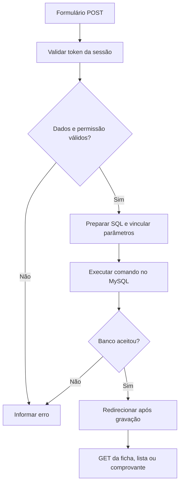
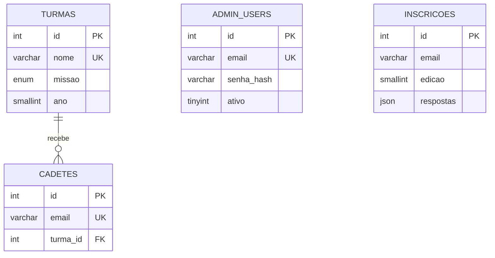

# Academia Meridiano · Documentação sistêmica e banco de dados

## 1. Aplicação e caminho dos dados

O portal apresenta a instituição e seleciona agentes para o Corpo Básico. A pessoa candidata escolhe a missão de interesse e envia a prova. A secretaria acompanha os convocados, registra o TAF e administra cadetes e turmas. A prévia HTML permite navegar offline. O portal em pub/ executa as operações persistentes.

| Arquivo | Responsabilidade |
|---|---|
| pub/index.php, institucional.php, formacao.php, especialidades.php | Ativam a sessão e compõem cabeçalho, conteúdo e rodapé. |
| pub/missoes.php, galileia.php, brasil.php, guerra.php, futuro.php | Apresentam o catálogo e os itinerários específicos. |
| app/header.php, footer.php e arquivos HTML | Navegação e conteúdo das páginas institucionais. |
| app/config.example.php, bootstrap.php | Configuração local ou por ambiente, sessão, PDO, tokens, autorização e escape. |
| pub/vestibular.php, app/prova.php | Recebem a inscrição, validam oito respostas, calculam os dois subtotais e salvam uma cópia da correção. |
| app/selecao.php, pub/taf.php | Aplicam os critérios de habilitação e registram as marcas presenciais. |
| pub/secretaria.php, usuarios.php, dashboard.php | Entrada pública com sessão, redirecionamento da antiga tela de contas e painel acadêmico. As contas administrativas são independentes das inscrições e dos cadetes. |
| pub/gestao.php, registro.php, app/catalogo.php | Consulta paginada e manutenção de turmas e cadetes, com listas permitidas de entidades, missões e especialidades. |

Nos dois CRUDs, o formulário novo gera INSERT. A edição usa o ID para SELECT, preenche os campos, valida novamente e executa UPDATE. A exclusão exige sessão administrativa, POST, token e confirmação marcada. Cada formulário recebe dados pelo nome dos campos em $_POST. GET identifica a página, o registro ou os critérios de consulta. Os campos obrigatórios e os limites presentes no HTML são verificados novamente pelo PHP, inclusive e-mail, ano, domínio das opções e existência da turma.

A conexão PDO usa DSN MySQL, utf8mb4, exceções e prepares nativos. A função query() chama prepare(), percorre os parâmetros com bindValue() e executa execute(). fetch() retorna uma linha associativa; fetchColumn() obtém contagens ou IDs. Inteiros de LIMIT e OFFSET são vinculados como PDO::PARAM_INT. Valores de formulário são parâmetros; nomes de tabela e expressões de ordenação vêm de opções fixas. O HTML escapa dados com htmlspecialchars().

A consulta administrativa combina nome LIKE '%trecho%' e, opcionalmente, missão. Para cadetes, JOIN recupera a missão da turma. COUNT(*) determina o número de páginas. Cada página de gestão mostra até seis linhas, com OFFSET=(página−1)×6. A ordenação aceita A–Z, Z–A ou ID decrescente, com ID de desempate. Os links preservam entidade, busca, missão e ordem. A lista de convocados do TAF pagina de oito em oito.

## 2. Modelo lógico e dicionário

Uma turma recebe zero ou vários cadetes. Cada cadete tem exatamente uma turma. A inscrição é independente: ainda não há FK entre candidato e cadete. Em inscricoes, email e edicao formam juntos uma chave única. Todas as tabelas usam InnoDB. A definição executável está em [banco.sql](../sql/banco.sql).

| Tabela | Campo | Tipo MySQL | Significado e restrição |
|---|---|---|---|
| admin_users | id | INT UNSIGNED | PK automática da conta. |
| admin_users | nome | VARCHAR(100) | Nome exibido na Secretaria. |
| admin_users | email | VARCHAR(160) | Identificador único de login. |
| admin_users | senha_hash | VARCHAR(255) | Hash verificado no login. |
| admin_users | ativo | TINYINT(1) | Conta habilitada quando vale 1. |
| admin_users | criado | TIMESTAMP | Data de criação da conta. |
| turmas | id | INT UNSIGNED | PK automática. |
| turmas | nome | VARCHAR(100) | Nome obrigatório e único. |
| turmas | missao | ENUM | comum, galileia, brasil, guerra ou futuro. |
| turmas | ano | SMALLINT UNSIGNED | Ano letivo. |
| cadetes | id | INT UNSIGNED | PK automática. |
| cadetes | nome | VARCHAR(100) | Nome obrigatório. |
| cadetes | email | VARCHAR(160) | Obrigatório e único. |
| cadetes | ano_formacao | TINYINT UNSIGNED | Etapa de 1 a 4 na aplicação. Aceita NULL em históricos. |
| cadetes | especialidade | VARCHAR(70) | Corpo Básico ou designação. Aceita NULL em históricos. |
| cadetes | turma_id | INT UNSIGNED | FK obrigatória → turmas.id; ON DELETE RESTRICT. |
| inscricoes | id | INT UNSIGNED | PK automática usada no protocolo. |
| inscricoes | nome | VARCHAR(100) | Nome informado. |
| inscricoes | email | VARCHAR(160) | Obrigatório; único em combinação com a edição. |
| inscricoes | interesse | VARCHAR(20) | Destino pretendido, validado em PHP. |
| inscricoes | edicao | SMALLINT UNSIGNED | Regulamento aplicado; padrão 2. |
| inscricoes | gerais | TINYINT UNSIGNED | Acertos do bloco geral; NULL em históricos. |
| inscricoes | especificos | TINYINT UNSIGNED | Acertos do bloco específico; NULL em históricos. |
| inscricoes | nota | TINYINT UNSIGNED | Pontuação total obrigatória. |
| inscricoes | respostas | JSON | Cópia das oito questões respondidas, com bloco, tema, enunciado, alternativa marcada, gabarito e acerto. NULL quando a versão anterior não gravou esses dados. |
| inscricoes | corrida_m | SMALLINT UNSIGNED | Distância completada na estação de oito minutos, em metros. |
| inscricoes | percurso_s | SMALLINT UNSIGNED | Tempo do percurso de quatro trechos, em segundos. |
| inscricoes | avaliador | VARCHAR(100) | Nome do responsável pelo lançamento. |
| inscricoes | data_taf | DATE | Dia do teste. Os quatro campos do TAF ficam nulos até a avaliação. |
| inscricoes | criado | TIMESTAMP | Momento de criação, preenchido pelo banco. |

**Por que dividir assim?** A turma guarda seu destino e ano em um só lugar. A inscrição representa um processo seletivo, enquanto o cadete representa uma pessoa já matriculada. As respostas e notas entram no mesmo INSERT, evitando um protocolo com prova parcialmente salva.

**Como evitar inconsistências?** PK, FK, unicidade, NOT NULL e ENUM complementam a validação do PHP. Se dois envios chegam com o mesmo e-mail e edição, o índice único resolve a concorrência. A nota total é calculada no servidor.

**O que acontece na exclusão?** O banco rejeita a exclusão de turma ocupada. Excluir um cadete libera o vínculo e preserva a turma. Uma inscrição não é apagada pela exclusão de um cadete.

**Melhorias possíveis.** Relacionar matrícula e inscrição, normalizar missões e especialidades e criar restrições CHECK para intervalos de notas e coerência do TAF. Para analisar estatísticas por questão, extrair itens e respostas para tabelas vinculadas à versão da prova.

## 3. Cinco regras de negócio

| Regra e justificativa | Onde e como é aplicada | Como verificar |
|---|---|---|
| 1. Uma participação por e-mail e edição evita duplicidade de prova. | vestibular.php e índice único email_edicao em inscricoes. | Enviar duas vezes o mesmo endereço na edição 2. A segunda operação deve exibir o aviso e manter uma linha. |
| 2. Convocação exige 5 de 8 e pelo menos 2 em cada bloco, preservando o equilíbrio entre áreas. | vestibular.php calcula os blocos; selecao.php e taf.php aplicam os cortes. | Comparar 4+1, que não convoca, e 3+2, que convoca. |
| 3. Habilitação física exige ambos os índices, para avaliar resistência e agilidade. | selecao.php, taf.php e inscricoes. Limites inclusivos: 800 m ou mais e 40 s ou menos. | Testar 800/40 e 799/40 em candidatos distintos. O primeiro habilita; o segundo não. |
| 4. Somente a banca registra uma avaliação por convocado. | taf.php exige staff(), POST com token e UPDATE condicionado à edição, notas e data_taf IS NULL. | Confirmar marcas e repetir a submissão. O segundo envio deve preservar o primeiro registro. |
| 5. Primeiro ano usa Corpo Básico; etapas posteriores exigem especialidade para orientar atribuições. | registro.php e catalogo.php validam ano_formacao e especialidade antes de gravar cadetes. | Tentar 1º ano + Travessia e depois 1º ano + Corpo Básico. Apenas a segunda combinação deve ser aceita. |

## 4. Testes práticos e auditoria

**Execução local.** O script tests/sql_local.py executou os seis casos abaixo em SQLite com chaves estrangeiras habilitadas, traduzindo os tipos do DDL MySQL. As instruções de cadastro e edição vêm do código do projeto. A [evidência de cada teste](evidencias/sql-local.json) inclui o comando, o valor esperado e o valor efetivamente observado. Este ensaio cobre a camada relacional. A confirmação pelo formulário PHP e pelo MySQL está pendente.

| Caso | Resultado esperado | Resultado obtido e evidência |
|---|---|---|
| T1 Cadastrar turma | Retornar Aurora de auditoria, ano 2027. | Linha encontrada com os dois valores. JSON T1. |
| T2 Cadastrar cadete | Relacionar Lia Teste à turma criada. | JOIN retornou Lia Teste e Aurora de auditoria. JSON T2. |
| T3 Editar cadete | Alterar o nome mantendo o ID. | Busca por ID retornou Lia Revisada. JSON T3. |
| T4 Pesquisar e paginar | No filtro comum e trecho Aurora, pular a primeira ocorrência. | Retornou Primeiro ano · Aurora. JSON T4. |
| T5 Cadastro inválido | Rejeitar cadastro com turma inexistente e manter zero linhas com o e-mail de teste. | Erro de integridade referencial e contagem zero. JSON T5. |
| T6 Excluir cadete | Remover a linha de ID conhecido. | SELECT posterior retornou contagem zero. JSON T6. |

**Teste de integração preparado.** O workflow .github/workflows/auditoria.yml sobe MySQL 8.4 e PHP 8.3, importa o SQL em banco descartável e chama tests/integracao.py. Os seis casos HTTP cobrem inscrição com oito respostas persistidas, cadastro de turma, edição, pesquisa filtrada, rejeição de ano inválido e exclusão. A cada sucesso são salvos HTML e JSON com resultado real. No GitHub, baixe o artefato evidencias-php-mysql no job concluído. A evidência do CI só existe após uma execução.

**Falha observada.** Faltava o separador entre as questões 6 e 7 no array PHP. Isso comprometia o carregamento da prova; a vírgula foi corrigida. Uma segunda lacuna era gravar apenas a nota: uma revisão não conseguiria reconstruir as escolhas. A nova coluna respostas guarda o espelho de cada novo envio. Não é possível recuperar alternativas de inscrições anteriores que só guardaram totais.

## 5. Análise crítica

1. **Funcionalidade mais complexa.** A passagem da prova para o TAF combina edição, notas por bloco, convocação e marcas presenciais. Uma nota total isolada não decide o resultado. A data nula também protege contra dois lançamentos simultâneos.
2. **Maior risco.** A secretaria pode cadastrar um cadete sem vinculá-lo à inscrição habilitada ou associá-lo a uma turma incompatível com a etapa. O banco aceita essas combinações. Uma FK de matrícula e validação conjunta da etapa e missão reduziriam esse risco.
3. **Por que PDO?** A aplicação usa uma API consistente para parametrizar valores, buscar resultados e tratar exceções. Prepared statements mantêm dados separados da instrução SQL; autorização, escape HTML e validação continuam necessários.
4. **Mudança arquitetural.** Concentrar as políticas de convocação e os limites do TAF em um único serviço de domínio e separar os repositórios PDO da apresentação. Assim, mudanças de edital não exigem sincronizar trechos de SQL e PHP manualmente.
5. **Nova funcionalidade.** Histórico de lotações temporais. Uma tabela lotacoes(cadete_id, turma_id, inicio, fim) guardaria a passagem do agente por várias turmas e o encerramento da lotação anterior seria transacional.
